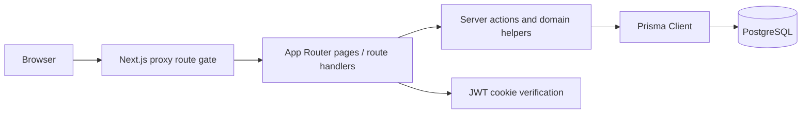

# System Architecture SIMUKPBJ

> Verified snapshot 2026-10-17.

## Stack

- Next.js 16.2 App Router, React 19, TypeScript, Tailwind CSS 4.
- Server Components, Route Handlers, and Server Actions.
- Prisma Client/ORM 6.19.3 with PostgreSQL.
- JWT cookie authentication (`dinkes_pbj_session`), bcrypt password hashing.
- Chart.js 4 for Dashboard visualization.
- Docker Compose; repository Compose exposes app port 3000. Nginx is deployment context but no Nginx config is present in this repository (**NEEDS VERIFICATION**).

## Runtime architecture

## Shared UI shell

Protected module layouts render `ProtectedDashboardLayout`, which verifies the session and wraps children in `DashboardShell`. The shell owns one shared `Sidebar`; pages render the shared `AppHeader`. Dashboard-specific code must remain within its content area and must not duplicate or mutate global navigation behavior.

Current desktop Sidebar is an overlay/drawer controlled by `SidebarStateProvider`; a backdrop is rendered when open. Mobile AppHeader uses the shared navigation mechanism. This describes code, not a claim that all viewport behavior has passed E2E tests.

## Authentication and authorization

1. Login route validates credentials, verifies bcrypt hash, signs an 8-hour JWT, and stores it in a cookie.
2. `proxy.ts` checks cookie presence and performs route gating using roles decoded from JWT payload. This payload is not signature-verified in proxy; it is only a navigation gate.
3. Server code uses `getCurrentUser()`/`verifySessionToken()` to verify signature.
4. Sensitive route handlers/server actions must additionally enforce role and object/unit scope. UI menu filtering is not a security boundary.

## Data flow

- Pages generally query Prisma directly through server-side helpers or use internal APIs from client components.
- Dashboard calls `getDashboardData()` -> scoped Prisma RUP query -> pure transformation functions -> server-rendered cards and client Chart.js components.
- Dashboard is dynamic; workflow mutations call path revalidation where implemented.
- E-Purchasing uses a Server Action with Zod, auth/role, eligibility and completeness guards, Prisma write, then revalidation.

## API surface

Routes exist for auth, dashboard, RUP/import, packages/history, contracts/adenda, realization, progress, handover, reports, master data, notifications, audit, warnings, suppliers, and administration. Route existence does not imply identical RBAC coverage; see [RBAC matrix](RBAC_MATRIX.md).

## Deployment and configuration

Required secrets/config include `DATABASE_URL` and `JWT_SECRET`; Compose also consumes PostgreSQL database/user/password variables. Never expose values client-side or commit `.env` files. Production sequence should build image, back up DB, run reviewed migrations, start app, and verify health/routes. Automatic deployment is outside agent authority.

## Caching/revalidation

- Protected layout and Dashboard use dynamic rendering.
- Mutations should call `revalidatePath`/`revalidateTag` for affected views; client workflows may also call `router.refresh()`.
- Do not globally disable caching to solve a local stale-data issue.

## Architecture risks

- Dual procurement data paths: RUP/E-Purchasing columns and generic execution models are not relationally unified.
- Proxy role decode is intentionally insufficient for authorization; missing server checks would be a security defect.
- Some large feature pages duplicate substantial presentation/domain code; maintainability review is recommended.
- No automated test runner/script is configured.

See [Database](DATABASE.md), [Security](SECURITY_STANDARD.md), [Coding standard](CODING_STANDARD.md), and [Workflow](WORKFLOW.md).
