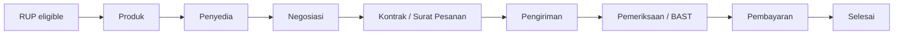

# Workflow SIMUKPBJ

> Canonical description audited 2026-10-17. Schema enums define allowed stored values; helper/action code defines currently enforced transitions.

## Perencanaan

```mermaid
stateDiagram-v2
  [*] --> DRAFT
  DRAFT --> MENUNGGU_VERIFIKASI_KEPALA_UNIT: submit operator
  PERLU_REVISI --> MENUNGGU_VERIFIKASI_KEPALA_UNIT: submit ulang
  MENUNGGU_VERIFIKASI_KEPALA_UNIT --> PERLU_REVISI: kepala unit meminta revisi
  MENUNGGU_VERIFIKASI_KEPALA_UNIT --> MENUNGGU_VALIDASI_PPK_PPTK: approve kepala unit
  MENUNGGU_VALIDASI_PPK_PPTK --> PERLU_REVISI: revisi PPK/PPTK
  MENUNGGU_VALIDASI_PPK_PPTK --> MENUNGGU_PERSETUJUAN_PA_KPA: validasi
  MENUNGGU_PERSETUJUAN_PA_KPA --> PERLU_REVISI: revisi PA/KPA
  MENUNGGU_PERSETUJUAN_PA_KPA --> SIAP_RUP: persetujuan
  SIAP_RUP --> RUP_TAYANG: proses RUP
```

| Tahap | Aktor | Guard/data |
|---|---|---|
| Draft/revisi | OPERATOR, SUPER_ADMIN | edit lalu submit; required fields divalidasi server |
| Kepala unit | LEADER, SUPER_ADMIN | unit scope + checklist + catatan bila revisi |
| Validasi | PPK/PPTK, SUPER_ADMIN | approval stage dan status asal |
| Persetujuan | PA/KPA, SUPER_ADMIN | approval stage dan status asal |
| RUP | UKPBJ/LPSE_ADMIN/SUPER_ADMIN menurut helper | ID/status SIRUP dan data publikasi |

`DIAJUKAN` tetap diterima sebagai legacy queue kepala unit. Status enum lain seperti `DIVERIFIKASI_KEPALA_UNIT` ada untuk representasi domain namun bukan node persisten utama pada helper transisi aktif.

## E-Purchasing

| Tahap | Trigger dan data utama | Kondisi lanjut |
|---|---|---|
| Produk | nama, jumlah, satuan, platform, harga tayang | field wajib valid dan batas DB dipatuhi |
| Penyedia | identitas/kontak penyedia | kelengkapan tahap produk |
| Negosiasi | penawaran, kesepakatan, status | nilai positif dan prerequisite |
| Kontrak/SP | SPPBJ/SP/SPK/SPMK | bukti kontrak/SP tersimpan |
| Pengiriman | status, rencana/aktual, surat jalan | prerequisite kontrak |
| Pemeriksaan | uji fungsi/pemeriksaan/BAST | prerequisite pengiriman |
| Pembayaran | status dokumen, status bayar, nilai, invoice/faktur/tanggal | prerequisite pemeriksaan |
| Selesai | marker final | `SELESAI` atau `DIBAYAR` |

Server action melakukan authentication, role check, Zod validation, eligibility, prerequisite/completeness, Prisma update, error mapping, dan `revalidatePath`. Reset tersedia tetapi tidak boleh dipakai untuk menghapus record produksi tanpa otorisasi proses.

## Tender/Non-Tender dan transaksi umum

Route dan model umum (`PaketPengadaan`, `Kontrak`, `ProgresPaket`, `SerahTerima`, `RealisasiBelanja`) tersedia. State detail khusus Tender/Non-Tender belum setara dengan workflow E-Purchasing (**PARTIAL**); jangan mengarang transisi yang tidak ada di handler.

## Current-stage Dashboard

Setiap RUP ditentukan satu kali ke tahap terjauh berdasarkan field tersimpan: selesai -> pembayaran -> BAST -> pengiriman -> kontrak -> pemilihan -> RUP -> verifikasi -> perencanaan. Mapping ini dipakai untuk distribusi tahap dan hitungan ready/in-progress/done.

## Revisi dan penolakan

- Workflow perencanaan memakai `PERLU_REVISI`, bukan status `DITOLAK` pada `StatusUsulan`.
- `RupStatus.DITARIK` dan `REVISI_PAGU` khusus siklus RUP.
- `PaketStatus.GAGAL/BATAL` tersedia pada model paket umum; E-Purchasing mendeteksi kata GAGAL/BATAL pada marker/kendala.

## Cross references

[Business rules](BUSINESS_RULES.md) · [Validation](VALIDATION_STANDARD.md) · [RBAC](RBAC_MATRIX.md) · [Diagram HTML](diagram-paket-pengadaan.html)
